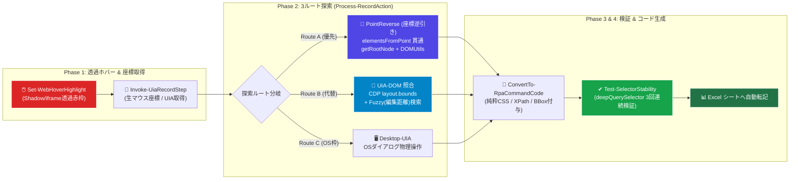

<h4 align="center">汎用RPA操作エンジン (VBA × PowerShell × WebView2 Hybrid-Engine / v303)</h4>

<p align="right">
  <sub>作成日: 2026年10月24日 / 作成者: System beginner & AI Collaborator (Gemini)</sub>
</p>

<p align="center">
  
</p>

### 🚀 概要 (Overview)
レガシーなイントラネット業務システム（財務会計システム等）から、Shadow DOM、多段iframe、動的生成UIなどのDOM構造を持つWebアプリケーションまでを操作するための汎用RPAエンジンです。<br>
ブラウザ更新に伴う外部WebDriver（Selenium等）のバージョン不一致や、専用ソフトウェアのインストール作業を不要とし、Windows標準の **PowerShell 5.1** と **WebView2ランタイム**（および同梱のDLLファイル配置）で稼働します。

| 項目 | 内容 |
| :--- | :--- |
| ① Shadow DOMの完全透過と安定性テスト | SalesforceなどのモダンWebで多用されるShadow DOMを透過。IDやクラスがない要素でも階層CSSセレクタを自動生成し、取得直後に「3回連続の安定性テスト」を行うことでFlaky（不安定）な動作を防止します。 |
| ② 多段iframeの絶対座標自動計算 | iframe内の要素を物理クリックする際、親フレームの枠オフセットをトップ画面まで再帰的に加算し、OS基準の絶対座標（Screen X/Y）を正確に算出します。 |
| ③ 透過・隠蔽UI（モダンUI）の自動判別 | 本来の `<input>` が透明化・サイズ0で隠蔽されているモダンUIにおいて、実際に可視サイズと不透明度を持つ「ユーザーが見ている装飾要素（span等）」を自動で判別・捕捉します。 |
| ④ リアルタイム・ホバーハイライト | マウス移動（mousemove）に追従し、Shadow DOMや同一オリジンiframe内部の要素も赤枠でリアルタイムに表示。 |
| ⑤ 最適化された通信負荷と応答速度 | 座標逆引き（PointReverse）を優先し、CDPによる巨大なDOMスナップショット取得をオンデマンド化。また、JSON-RPC受信時のマルチバイト文字のチャンク結合を最適化し、約1秒（実測1062ms）の高速なピッカー応答を実現しました。 |

---
### ✨ 主要な設計方針 (Core Concepts)
* **インストーラー不要のポータブル構成 (Portable Operation)**
  インストーラーの実行や管理者権限を必要とせず、スクリプトと必要ライブラリ（Libs フォルダ内のWebView2 DLL群および JsonConverter.bas）の配置のみで稼働します。制限のある端末環境でも運用可能です。
* **複数制御方式の併用 (Native + CDP + UIA)**
  JavaScriptによるDOM操作が機能しないWeb要素に対し、CDP（Chrome DevTools Protocol）や UIAutomation / Win32 API を用いたOSレベルの物理操作（マウスクリック・キーボード入力）へフォールバックします。
* **「基幹」と「拡張」のモジュール分離 (Core & Extension Architecture)**
  ブラウザ起動と通信を担う「基幹モジュール」と、用途に応じた「拡張モジュール」にファイルを分離しています。Win32 APIやアセンブリのロードは Ps_Engine_Core_v303.ps1 に集約しています。
* **JSONによる型と状態の維持 (Type Retention)**
  VBA ⇔ PowerShell ⇔ JavaScript のプロセス間通信において、通信データをJSONペイロードに規格化しています。また、動的パラメータはBase64エンコード（ConvertTo-JsSafeBase64）を介して受け渡すことで構文エラーを防ぎ、データ型に基づいたエラーハンドリングを行います。

---
### 🏗️ アーキテクチャ図解 (Architecture)
プロセス間の独立性を保ちながら、標準入出力（パイプ）を介して非同期・疎結合に同期をとります。

```text
  +-------------------------------------------------------------+
  |                         VBA (Excel)                         |
  |  - JSONペイロード送信 ／ 応答待ち・タイムアウト監視             |
  +------------------------------+------------------------------+
                                 | (標準入出力パイプ通信)
                                 v
  +-------------------------------------------------------------+
  |               PowerShell 5.1 (Ps_Engine_Core)               |
  |  - Win32 API一括ロード ／ JSONルーティング / 例外パース        |
  +------------------------------+------------------------------+
                   (ドットソース結合モジュール群)
              | (基幹モジュール)                 | (拡張モジュール)
              v                                  v
  +-----------------------+              +----------------------+
  | WebView2_Init/Native  |              | WebAction / WebXPath |
  | WebCDP / WebJS        |              | DesktopUIA / DevTools|
  +-----------------------+              +----------------------+
                 WebView2 フォーム・ブラウザコア
              |                                  |
              | (経路A: Native制御)               | (経路B: CDP / UIA制御)
              | - ExecuteScriptAsync             | - WebSocket通信 / Win32 API
              v                                  v
  +-------------------------------------------------------------+
  |    ターゲットWebページ (DOM / iframe / Shadow DOM) / OS       |
  +-------------------------------------------------------------+
```

---
### ⚡クイックスタート (VBA記述イメージ)
**VBA側からは、多段iframeやShadow DOMの階層を個別に指定することなく、共通のコマンド形式でWeb画面を操作できます。**

```vba
Dim rpaEngine As New Ps_Engine

' 1. エンジンの起動 (CDP高速通信モード: Port 9222)
rpaEngine.StartEngine "SESSION_01", ThisWorkbook.Path & "\Ps_Engine_Core_v303.ps1", 9222, True

' 2. ページ遷移と読み込み待機 (同一オリジンiframeのDOM完了まで再帰チェック)
rpaEngine.RunAction "Invoke-WebNavigation", CreateParams("Url", "https://example.com/login")
rpaEngine.RunAction "Wait-WebPageLoad"

' 3. 入力とクリック (同一オリジンiframeやShadow DOMを透過探索、失敗時はOS物理操作へフォールバック)
rpaEngine.RunAction "Set-WebTextInput", CreateParams("Selector", "#username", "Value", "admin_user")
rpaEngine.RunAction "Invoke-WebClick", CreateParams("Selector", "button.login-submit")

' 4. 業務システム特有の「処理中オーバーレイマスク」が非表示になるまで待機
rpaEngine.RunAction "Wait-WebScreenUnlock", CreateParams("TimeoutSec", 30)

' 5. 画面上のテーブルを2次元配列データとして取得 (rowspan/colspanの結合セル展開に対応)
Dim vbaData As String
vbaData = rpaEngine.RunAction("Export-WebTableToCsv", CreateParams("Selector", "table.data-grid", "ExpandMergedCells", True))
```

---
### 🎯 主な機能 (Key Features)
#### 🛡️ Robust DOM (非表示要素の除外とクリック)
* **フェーズ1 (Get-WebCssSelectorHint):** XPath指定から画面上に表示されている要素を抽出し、CSSセレクタを逆算生成します。
* **フェーズ2 (Invoke-WebSafeClick):** display: none だけでなく、CSS透明度（opacity）や要素サイズ（幅・高さ）を評価し、画面中央へのスクロールと可視性確認を行ってからクリックを実行します。

#### 👻 多段iframe & Shadow DOMの透過探索
WebView2の初期化フェーズにて、Shadow DOMを再帰探索する関数（deepQuerySelector）や同一オリジンiframeを透過探索する関数（utilFindInFrames）を AddScriptToExecuteOnDocumentCreatedAsync で自動注入します。

#### 🔍 OS・ブラウザ間の座標変換と要素ピッカー (DevTools)
マウスポインタ下の要素を画面上から取得し、セレクタとコマンド情報を出力するGUIピッカー機能を備えています。
* **リアルタイム・ホバーハイライト (Set-WebHoverHighlight):** マウス移動に追従し、Shadow DOMや同一オリジンiframe内部の要素を赤枠でハイライト表示します。
* **座標逆引きとUIA照合 (PointReverse & UIA-DOM):** OS物理座標からDPR（ディスプレイ拡大率 125%等）とスクロール量、親iframeの枠オフセットを補正してDOM要素を特定します。また、本来の <input> が透明化・サイズ0で隠蔽されているモダンUIでは、可視サイズを持つ装飾要素（span 等）を判別して捕捉します。
* **セレクタ安定性テスト (Test-SelectorStability):** 要素取得直後にセレクタの連続存在確認テストを実行し、動的IDやDOM再描画によるセレクタの不整合を確認します。



#### 📚 Fetch APIによるバックグラウンド保存 & 仮想タブ管理
* **ダイアログを介さないファイル保存 (Enable-SilentDownload / Invoke-WebFetchDownload):** Edge内蔵のPDFビューア等で「名前を付けて保存」ダイアログの操作が不安定になるケースに対し、現在のセッション（Cookie等）を利用してFetch APIでバイナリデータを取得し、指定パスへ直接保存します。
* **ポップアップの仮想タブ化:** window.open 等の別ウィンドウ要求をインターセプトし、エンジン内部の仮想タブとして生成します。window.opener の親子関係を維持したまま操作し、window.close 時は自動でコントロールの破棄と親画面への復帰を行います。

---
### 📁 ディレクトリ構成 (Directory Structure)
システム一式を任意のローカルフォルダに配置するだけで稼働します。

```text
 [RPA実行ルートフォルダ]
 ├─ Ps_Engine_Core_v303.ps1          (司令塔・ルーター・Win32API/UIA一括ロード)
 │
 ├─✨ [基幹モジュール] (ブラウザ起動と通信に使用する4ファイル)
 │   ├─ Lib-WebJS_v303.ps1           (ブラウザ全画面へのJS自動注入ユーティリティ)
 │   ├─ Lib-WebView2_Init_v303.ps1   (ブラウザ画面生成・仮想タブ管理・クラッシュ保護)
 │   ├─ Lib-WebView2_Native_v303.ps1 (Native API通信・指数バックオフリトライ)
 │   └─ Lib-WebCDP_v303.ps1          (WebSocket・CDP通信)
 │
 ├─✨ [拡張モジュール] (用途に応じた機能群)
 │   ├─ Lib-WebAction_v303.ps1       (標準DOM操作・待機・物理フォールバック・Fetch DL)
 │   ├─ Lib-WebXPath_v303.ps1        (XPath操作・表記揺れ正規化)
 │   ├─ Lib-WebSafeAction_v303.ps1   (可視性確認クリック・透過ホバーハイライト)
 │   ├─ Lib-DesktopUIA_v303.ps1      (OSネイティブ・Win32API物理操作・ダイアログ操作)
 │   ├─ Lib-DevTools_v303.ps1        (GUIピッカー・座標逆引き・セレクタ生成)
 │   └─ Lib-WebDebug_v303.ps1        (DOMスナップショット・結合対応テーブルCSV・証跡保存)
 │
 ├─ 実行用マクロファイル.xlsm        (VBA司令塔: Ps_Engine.cls / Ps_Bridge.bas / UserForm_Picker)
 │
 ├─ [ Libs ]                         (WebView2関連DLL: Core, WinForms, Loader)
 │  ├─ Microsoft.Web.WebView2.Core.dll
 │  ├─ Microsoft.Web.WebView2.WinForms.dll
 │  └─ WebView2Loader.dll
 │
 ├─ [ sandbox ]                      (ローカル検証用テストHTML群: Shadow DOM, マスク待機等)
 ├─ [ Logs ]                         (実行ログ・スクショ等の出力先: 5世代自動ローテーション)
 └─ [ UserData ]                     (WebView2独立ユーザーデータフォルダ: 通常Edgeと環境分離)
```
 
🛠️ **必要なもの** (Requirements)<br>
* Windows 10 / 11
* PowerShell 5.1 (Windows標準)
* Microsoft Edge WebView2 ランタイム
* Microsoft Excel (VBA環境)
* VBAライブラリ: VBA-JSON v2.3.1 (JsonConverter.bas)

&emsp;&emsp;&emsp; **Note:** VBEの [ツール] → [参照設定] にて Microsoft Scripting Runtime にチェックを入れてください。

---
### 📚 ドキュメント (Documentation)
モジュール別の関数リファレンスや通信プロトコル、各テストの実行記録については以下のドキュメントを参照してください。

| カテゴリ | ドキュメントファイル | 内容 |
| :--- | :---: | :--- |
| 導入ガイド | [セットアップ.md)](./docs/m01_%E3%82%BB%E3%83%83%E3%83%88%E3%82%A2%E3%83%83%E3%83%97(Getting%20Started).md) | 初期配置、DLLの準備、Excel参照設定などの導入手順 |
| 総合仕様書 | [開発・運用 (MANUAL.md)](./docs/m02_rpa-Engine(%E9%96%8B%E7%99%BA%E3%83%BB%E9%81%8B%E7%94%A8)%E4%BB%95%E6%A7%98%E6%9B%B8.md) | 設計思想、座標変換の数理モデル、コーディング規約、全関数リファレンス |
| 関数テスト | m03_Engine(関数TEST)ローカルhtml.md<br>m04_Engine(関数TEST)公開サイト.md | 各モジュール関数の単体・結合テスト仕様（ローカル / 公開サイト） |
| シナリオ検証 | m11_コードテスト(ローカルhtml).md<br>m12_コードテスト(公開サイト).md<br>m13_コードテスト(要素ピッカー).md | Shadow DOM、マスク待機、PDFサイレントDL、<br>要素ピッカー座標テスト（T01〜T33）の実行記録 |

---
### 📜 ライセンス (License)
This project is licensed under the MIT License - see the [LICENSE](LICENSE) file for details.<br>
このプロジェクトは **MIT License** の下で公開されています。詳しくは [LICENSE](LICENSE) ファイルをご覧ください。
